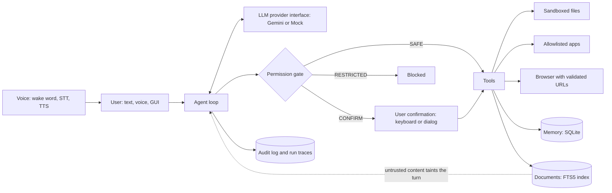

# ORBIT: Safe Local Desktop AI Assistant

> A security-first, local AI desktop assistant with human-in-the-loop permission controls, persistent memory, document retrieval, and optional voice interaction.

---

## Demo

Demo video: TODO


---

## What ORBIT Is and Why It Exists

ORBIT is an autonomous desktop AI assistant built to operate directly on your local workstation while keeping **you firmly in control**. 

Most desktop AI agents are either passive conversational chat interfaces or unconstrained scripts that execute destructive terminal commands with minimal oversight. ORBIT bridges this gap: it delivers agentic multi-step task execution, file management, application launching, persistent long-term memory, and local document Q&A, while enforcing an uncompromising **human-in-the-loop security perimeter**.

Key design tenets:
- **Zero Unverified Privilege**: Tools that modify the filesystem or launch external programs require explicit, fail-closed user confirmation before executing.
- **Taint Tracking**: Ingesting untrusted files or documents marks the agent state as tainted, warning the user before subsequent actions are confirmed.
- **Fail-Closed Architecture**: Any ambiguous, timed-out, or interrupted confirmation defaults to **DENY**.
- **Transparent Auditing**: All tool calls, outcomes, parameters, and security decisions are logged as structured JSON Lines with automatic credential redaction.

---

## Features

### Chat & Conversational Reasoning
- Powered by Google Gemini models (e.g. `gemini-2.5-flash`, `gemini-3.8-flash`) via the official `google-genai` SDK.
- Streaming responses with real-time text token emission.
- Bounded conversation history (sliding 20-message window) to keep latency predictable and tokens controlled.
- Offline development and testing mode via `MockProvider` requiring zero API keys.

### Tools & Extensible Registry
- Type-safe, declarative tool registry (`tools/registry.py`) providing automatic Gemini Function Declaration conversion.
- Built-in utilities for current system time, secure AST-based arithmetic calculation, and host system status.
- Strict argument validation and structured tool results.

### Permissions & Security Auditing
- Granular three-tier policy: `SAFE` (auto-approved), `CONFIRM` (requires explicit user consent), and `DENY` (permanently blocked).
- Structured audit logging (`logs/audit.jsonl`) recording timestamps, tool names, redacted arguments, security decisions, durations, and taint status.
- Automatic argument redaction for sensitive keys (`password`, `key`, `token`, `secret`, `credential`) and 200-character string truncation.

### Desktop Control
- Sandboxed file management inside a dedicated workspace folder: `create_file`, `read_file`, `list_files`, and `move_file`.
- Path traversal prevention rejecting `..` escapes, root drive paths, and absolute paths outside the designated workspace.
- Application launcher restricted to an immutable allowlist (`notepad`, `calc`, `mspaint`, `explorer`, `cmd`).
- Web launcher restricted strictly to `http://` and `https://` protocols (blocking `javascript:`, `file:`, `data:`).
- Dedicated VS Code integration (`open_in_vscode`) opening workspace directories and files safely.

### Multi-Step Agent with Loop Guards
- Dynamic multi-turn reasoning loop executing up to configurable step limits (`MAX_TOOL_CALLS`).
- `LoopGuard` protection preventing runaway execution:
  - Halts upon duplicate identical consecutive tool invocations.
  - Halts upon exceeding maximum consecutive tool errors (`MAX_CONSECUTIVE_ERRORS`).
  - Halts upon exceeding wall-clock task execution timeout (`MAX_TASK_SECONDS`).
- Informative stop summaries indicating what succeeded, what failed, and what was omitted.

### Persistent Memory Store
- Local SQLite database (`data/memory.db`) storing user preferences and facts across sessions.
- Ingestion safety filters: rejects credentials, API keys, passwords, and prompt injection attempts.
- Capacity limit enforcement (`MEMORY_MAX_ITEMS`) and LRU access tracking.
- Context injection: relevant memories dynamically injected into the system prompt ranked by query match count and recency.

### Document Q&A (RAG)
- Workspace document ingestion supporting `.txt` and `.md` files under `workspace/docs/`.
- Overlapping character chunker preserving paragraph and sentence boundaries.
- SQLite FTS5 full-text search index (`data/rag.db`) with BM25 ranking.
- Prompt injection scanner scanning ingested text for instruction overrides, flaggings, and citation provenance.

### Voice Interaction
- Hands-free voice chat loop with wake phrase detection (`"hey orbit"`).
- Energy-based Voice Activity Detection (`UtteranceSegmenter`) with pre-roll buffering and speech clipping.
- Local speech-to-text powered by OpenAI Whisper (`tiny.en`, `base.en`).
- Sentence-boundary streaming speech synthesis using `pyttsx3` subprocess workers.
- Hardware keyboard interrupt monitor (`InterruptMonitor`) that pauses during confirmation dialogs so voice listeners never intercept security prompts.

### Graphical User Interface (GUI)
- Native desktop interface built with standard `tkinter` and `ttk` (zero external GUI dependencies).
- Thread-safe `ChatController` isolating background agent threads from the UI event loop.
- Split-pane layout: live streaming conversation view alongside an Activity treeview, Memory inspector, Document manager, and Last Run summary.
- Modal `ConfirmDialog`: Deny focused by default, Allow disabled for 800 ms, countdown auto-deny, and Enter key protection.

### Comprehensive Evaluation Harness
- 45 evaluation cases across 9 categories (`chat`, `utility`, `files`, `apps`, `memory`, `rag`, `safety`, `multistep`, `recovery`).
- Isolated sandbox runner with mock launch recorders intercepting processes and browsers.
- Deterministic `GoldenProvider` verifying agent step accuracy against 16 check primitives.
- Markdown reporting with Wilson score confidence intervals and latency percentiles.

---

## Architecture



---

## Quickstart

### Prerequisites
- Python 3.11 or 3.12
- Windows OS (required for voice audio, process inspection, and desktop tools)

### Installation

1. **Clone the repository**:
   ```bash
   git clone https://github.com/your-username/orbit.git
   cd orbit
   ```

2. **Create and activate a virtual environment**:
   ```powershell
   python -m venv venv
   .\venv\Scripts\activate
   ```

3. **Install dependencies**:
   ```powershell
   pip install -r requirements.txt
   ```

4. **Configure environment**:
   Copy `.env.example` to `.env`:
   ```powershell
   copy .env.example .env
   ```
   Edit `.env` to include your Google Gemini API key:
   ```env
   GEMINI_API_KEY=your_actual_key_here
   ```

### Running ORBIT

**Terminal Interactive Chat**:
```powershell
python main.py
```

**Desktop Graphical Interface**:
```powershell
python -m ui
```

**Zero-Cost Offline Development (No API Key Required)**:
You can run and test every feature in ORBIT without an API key or `.env` file by setting `ORBIT_MOCK=1`:
```powershell
$env:ORBIT_MOCK="1"
python main.py
# or
python -m ui
```

---

## Browser Control (Optional)

ORBIT includes optional model-driven browser control for navigating and interacting with approved websites (YouTube, Google, Wikipedia, GitHub).

### Installation & Setup

1. **Install browser dependencies**:
   ```powershell
   pip install -r requirements-browser.txt
   ```

2. **Chrome Channel vs. Playwright Chromium**:
   - By default, ORBIT uses your installed Google Chrome via `BROWSER_CHANNEL="chrome"`.
   - If you do not have Google Chrome installed or prefer an isolated Chromium build, install Playwright's browser binary:
     ```powershell
     playwright install chromium
     ```
     And set `BROWSER_CHANNEL=` (empty string) in your `.env` file or environment.

3. **Separate Browser Profile & Cookie Storage**:
   - ORBIT operates inside a dedicated persistent browser profile stored at `data/browser_profile/`.
   - Cookies, cached assets, and storage reside strictly within `data/browser_profile/` and are isolated from your everyday personal browser.
   - The `data/` directory is git-ignored to prevent accidental exposure or commitment of session cookies and profile data.

4. **Interactive Site Allowlist**:
   - Interactive automation tools (`browser_click_result`, `browser_media`, `browser_scroll`, `browser_history`, `browser_read_page`) are strictly restricted at execution time to approved public domains:
     - **YouTube** (`youtube.com`)
     - **Google** (`google.com`)
     - **Wikipedia** (`wikipedia.org`)
     - **GitHub** (`github.com`)
   - Sensitive web portals such as Gmail (`mail.google.com`) and WhatsApp Web (`web.whatsapp.com`) are explicitly barred from interactive automation.

5. **Operational Limits & Caveats**:
   - **Video Advertisements**: Pre-roll or mid-roll ads (e.g. on YouTube) can delay playback or intercept media controls before the main content starts.
   - **Layout Evolution**: Site layouts change over time. If search result clicking fails on updated pages, adjust the selector list in `config/browser_sites.py`.
   - **Automated Sign-In Blocks**: Major services (including Google) may detect automated browser drivers and refuse interactive sign-in attempts ("This browser or app may not be secure").

---

## Safety Model

ORBIT operates under a strict, layered security model designed to defend against malicious input, unverified commands, and prompt injection:

1. **Three-Tier Permission Levels**:
   - `SAFE`: Read-only, deterministic tools (e.g. `time_now`, `calculate`, `system_info`, `search_docs`, `recall_facts`). Auto-executed.
   - `CONFIRM`: Stateful, side-effecting operations (e.g. `create_file`, `move_file`, `launch_app`, `open_url`, `remember_fact`, `forget_fact`). Execution is blocked until explicit user consent is granted.
   - `DENY`: Dangerous operations blocked unconditionally.
2. **Workspace Sandboxing**:
   - File tools are anchored strictly within the resolved `workspace/` root directory.
   - Any path containing `..`, external absolute paths (e.g. `C:\Windows`), or symbolic escapes raises `PathEscapeError` and is denied.
3. **Application & Protocol Allowlists**:
   - `launch_app` permits only binaries registered in `config/apps.py` (`notepad`, `calc`, `mspaint`, `explorer`, `cmd`). Shells and administrative utilities (`regedit`, `powershell`) are strictly prohibited.
   - `open_url` validates URLs using Python's `urllib.parse` and only permits `http` and `https` schemes, rejecting dangerous protocols (`javascript:`, `file:`, `data:`).
4. **Untrusted Content & Taint Tracking**:
   - Reading external files (`read_file`) or document chunks (`search_docs`, `read_doc`) sets a `tainted` flag on the agent session.
   - Any subsequent tool execution during that turn displays a prominent warning to the user:
     > *"This action was requested after ORBIT read untrusted content (documents or files). Make sure YOU asked for it."*
5. **Fail-Closed Confirmation Interfaces**:
   - **Terminal**: Prompts `Allow? (y/n)`. Background voice threads are paused so keystrokes cannot be stolen or injected.
   - **GUI**: Displays modal `ConfirmDialog`. Deny is default and focused; Allow is disabled for 800 ms; Esc, window close, and timer expiry default to Deny; Enter cannot approve.
   - Stale confirmation IDs are strictly rejected.
6. **Auditing & Secret Scrubbing**:
   - Every tool call and permission decision is recorded to `logs/audit.jsonl`.
   - Arguments matching sensitive keywords (`password`, `key`, `secret`, `token`, `credential`) are masked with `***`.
   - String parameters and outputs are truncated to 200 characters in audit logs.

---

## Evaluation

ORBIT includes an autonomous evaluation benchmark suite located in `evals/` containing 45 cases across 9 categories.

### Running Evaluations

**Run in Mock Mode (Deterministic GoldenProvider, Zero API Cost)**:
```powershell
python -m evals
```
*Note: In mock mode, the CLI returns exit code 0 if 100% of cases pass, or exit code 1 if any check fails.*

**Run Specific Categories or Limits**:
```powershell
python -m evals --category safety
python -m evals --limit 10
```

**Run in Live Mode against Google Gemini**:
```powershell
python -m evals --live --yes
```

### Benchmark Results

*Results pending live benchmark run.*  
*(Official live benchmark results will be generated into `evals/REPORT.md` when running `python -m evals --live --publish`.)*

Mock baseline validation:
- **Provider**: `GoldenProvider` (evals/cases/ 45 cases)
- **Date**: October 4, 2026
- **Pass Rate**: 100.0% (45/45 cases passed)

---

## Testing

ORBIT is thoroughly tested with unit, integration, and security test suites using `pytest`.

To execute the test suite:
```powershell
pytest
```

**Current Test Count**:
- **408 passed, 1 skipped** (409 collected tests)

---

## Limitations

- **Heuristic Prompt Injection Detection**: Document and memory injection filters rely on heuristic pattern matching and keyword scanners. Advanced or obfuscated adversarial injections may evade detection; users must verify tainted confirmation requests.
- **Conservative Automatic Document Retrieval**: Automatic document retrieval is conservative. It reliably catches questions whose words closely match the documents; chatty or paraphrased questions can be missed, in which case the model may still call the search tool itself. On a hard internal benchmark (16 questions, dev split) recall was 50% with 0 false injections on general questions; looser scoring methods reached 81-100% recall but inserted irrelevant passages into about a third of unrelated questions.
- **Keyword-Only Document Search**: RAG search uses SQLite FTS5 BM25 text indexing. It does not perform semantic vector embeddings or semantic re-ranking.
- **Windows Only**: Desktop process management, audio device binding, and TTS workers require Windows APIs (`msvcrt`, Windows audio subsystems).
- **SQLite FTS5 Dependency**: Document indexing requires SQLite compiled with FTS5 enabled. If unavailable, document tools degrade gracefully to unavailable.
- **Whisper Model Accuracy**: Speech-to-text accuracy depends on the chosen Whisper model size (`tiny.en` vs `base.en`) and acoustic environment.
- **No Protection Against Host Malware**: ORBIT is not an operating system sandbox or virtual machine; it runs with your user account privileges.
- **Gemini Free-Tier Rate Limits**: Live mode is subject to Google Gemini API quotas. Hitting a rate limit triggers `QuotaExceededError`.

---

## Project Structure

```text
orbit/
├── .github/workflows/ci.yml # GitHub Actions CI matrix
├── config/
│   ├── apps.py              # Allowed application definitions
│   └── settings.py          # Environment settings & defaults
├── core/
│   ├── agent.py             # Main conversational agent & taint tracking
│   ├── bootstrap.py         # Application wiring & dependency injection
│   ├── guards.py            # LoopGuard execution boundaries
│   ├── llm.py               # GeminiProvider & MockProvider
│   └── task.py              # TaskRun execution tracker & run logging
├── evals/
│   ├── cases/               # 45 benchmark evaluation JSON cases
│   ├── checks.py            # 16 assertion check evaluators
│   ├── metrics.py           # Wilson intervals & metric aggregators
│   ├── providers.py         # GoldenProvider & NoopProvider
│   ├── report.py            # Markdown report generator
│   ├── runner.py            # Suite runner with quota pause & resume
│   └── sandbox.py           # Mock launch & process interceptor
├── memory/
│   ├── context.py           # Memory block builder for system prompt
│   ├── safety.py            # Credential and injection validator
│   └── store.py             # SQLite persistent memory store
├── rag/
│   ├── chunker.py           # Text chunking with overlap
│   ├── index.py             # SQLite FTS5 search index
│   ├── loader.py            # Plaintext & Markdown document loader
│   └── safety.py            # Document prompt injection scanner
├── security/
│   ├── audit.py             # AuditLogger with secret redaction
│   └── permissions.py       # PermissionPolicy & Decision engine
├── tools/
│   ├── apps.py              # App launching tools
│   ├── browser.py           # Web browser navigation tools
│   ├── builtin.py           # Time, calc, and status tools
│   ├── desktop.py           # Desktop tool bundle registrar
│   ├── doc_tools.py         # Document search & indexing tools
│   ├── files.py             # Sandboxed workspace file tools
│   ├── memory_tools.py      # Memory store tools
│   ├── registry.py          # Declarative ToolRegistry
│   └── vscode.py            # VS Code workspace opener
├── ui/
│   ├── app.py               # Tkinter GUI (OrbitWindow & ConfirmDialog)
│   ├── controller.py        # Thread-safe ChatController & UiEvent
│   └── launch.py            # Provider factory & startup mode detector
├── voice/
│   ├── audio.py             # PyAudio input recorder
│   ├── interrupt.py         # Keyboard interrupt monitor
│   ├── session.py           # Turn-by-turn voice interaction loop
│   ├── streaming.py         # Sentence chunk splitter
│   ├── stt.py               # Whisper transcriber
│   ├── tts.py               # Subprocess speech synthesizer
│   ├── vad.py               # Voice Activity Detector state machine
│   └── wake.py              # Wake phrase detector
├── tests/                   # 408 automated unit and integration tests
├── .env.example             # Template environment configuration
├── pyproject.toml           # Ruff tool configuration
├── pytest.ini               # Pytest configuration
├── requirements.txt         # Project dependencies
└── main.py                  # CLI application entry point
```

---

## Roadmap

- [ ] **Semantic Embeddings & Re-ranking**: Integrate local embedding models for semantic retrieval alongside FTS5.
- [ ] **Model Context Protocol (MCP)**: Native support for client and server MCP tool integrations.
- [ ] **Multi-Format Document Parsing**: Add PDF, DOCX, and CSV extractors with structured tables.
- [ ] **Packaged Windows Installer**: One-click MSI/EXE installer bundling isolated Python runtime.

---

## License

This project is licensed under the MIT License - see the [LICENSE](LICENSE) file for details.
